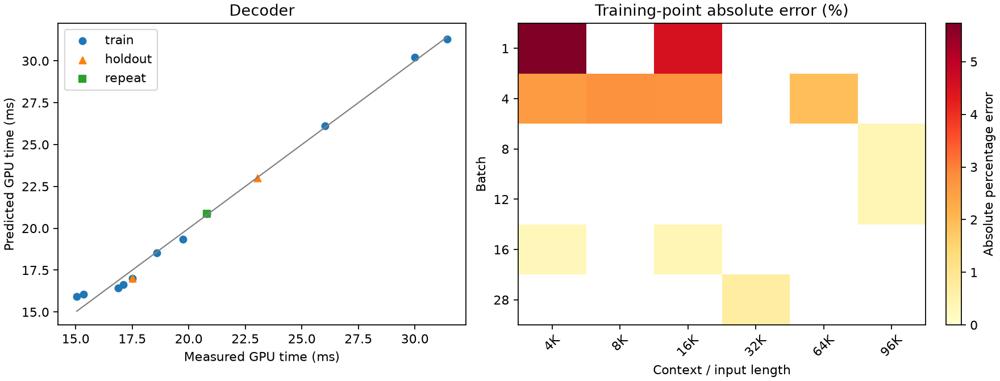
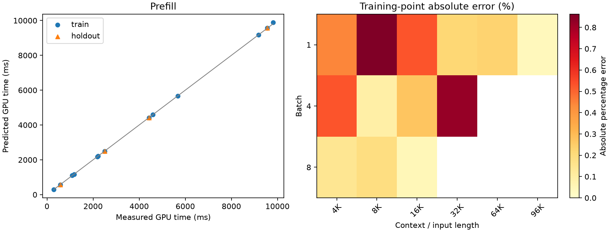

# Qwen3.8 A100 TP=4 calibration

**Scope:** pilot / incomplete registered grid

SGLang 0.5.21; BF16 weights/KV; FlashInfer; native communication selection.

Times cover GPU forward only. Loading, compilation, input preparation and sampling are excluded.

Primary timings use rank 0. All-rank samples and per-iteration maxima are diagnostics only.

No added per-sample TP barrier. Numerical forward checks run in separate validation processes.

TP=4 prefill is an extension of the reference TP=1 measurement.

Training data determine coefficients; holdout and repeat data do not enter fitting.

| Phase | Evaluation | N | MAPE (%) | P95 error (%) | Max error (%) |
|---|---|---:|---:|---:|---:|
| decoder | train | 11 | 2.04 | 5.13 | 5.73 |
| decoder | cv_checkerboard5 | 11 | 3.24 | 5.74 | 7.05 |
| decoder | holdout | 2 | 1.48 | 2.59 | 2.72 |
| prefill | train | 13 | 0.34 | 0.84 | 0.86 |
| prefill | cv_leave_one_out | 13 | 0.53 | 1.49 | 2.16 |
| prefill | holdout | 4 | 0.37 | 0.83 | 0.93 |

## Coefficients

```json
{
  "decoder": {
    "t0_ms": 15.732271708109545,
    "tB_ms_per_request": 0.12663240169134624,
    "tK_ms_per_kv_gb": 0.18174818651965097
  },
  "prefill": {
    "p0_ms": 26.327949859521954,
    "pN_ms_per_token": 0.0643202656657138,
    "pA_ms_per_mega_attention_pair": 0.6650767072621908,
    "linear_tokens_per_s": 15547.199465829544
  }
}
```

## Accuracy by measured region

### Decoder: largest observed point errors

- train: batch=1, length=4096, measured=15.046 ms, predicted=15.908 ms, error=5.73%.
- train: batch=1, length=16384, measured=15.357 ms, predicted=16.054 ms, error=4.54%.
- train: batch=4, length=8192, measured=17.102 ms, predicted=16.629 ms, error=2.76%.
- train: batch=4, length=16384, measured=17.497 ms, predicted=17.019 ms, error=2.73%.
- holdout: batch=4, length=16384, measured=17.495 ms, predicted=17.019 ms, error=2.72%.



### Prefill: largest observed point errors

- holdout: batch=1, length=8192, measured=580.961 ms, predicted=575.556 ms, error=0.93%.
- train: batch=1, length=8192, measured=580.561 ms, predicted=575.556 ms, error=0.86%.
- train: batch=4, length=32768, measured=9804.700 ms, predicted=9885.155 ms, error=0.82%.
- train: batch=1, length=16384, measured=1175.618 ms, predicted=1169.416 ms, error=0.53%.
- train: batch=4, length=4096, measured=1096.683 ms, predicted=1102.467 ms, error=0.53%.



## Repeat stability

```json
[
  {
    "bs": 16,
    "ctx": 16384,
    "first": 20.801808675130207,
    "repeat": 20.809932454427084,
    "diff_percent": 0.039053235340009596
  }
]
```

## Coverage

Validated shapes: 31/36 selected.
Missing or unselected points are not automatically classified as OOM.

```json
{
  "missing_selected_shapes": [
    {
      "id": "pre_train_g2",
      "batch": 8,
      "length": 32768
    },
    {
      "id": "pre_train_g3",
      "batch": 4,
      "length": 65536
    },
    {
      "id": "pre_train_g4",
      "batch": 2,
      "length": 98304
    },
    {
      "id": "pre_holdout_g0",
      "batch": 8,
      "length": 32768
    },
    {
      "id": "pre_holdout_g2",
      "batch": 2,
      "length": 98304
    }
  ],
  "registered_groups_without_file": [
    "dec_train_bs1_ctx8192",
    "dec_train_bs1_ctx12288",
    "dec_train_bs1_ctx24576",
    "dec_train_bs1_ctx32768",
    "dec_train_bs1_ctx65536",
    "dec_train_bs1_ctx98304",
    "dec_train_bs2_ctx4096",
    "dec_train_bs2_ctx8192",
    "dec_train_bs2_ctx12288",
    "dec_train_bs2_ctx16384",
    "dec_train_bs2_ctx24576",
    "dec_train_bs2_ctx32768",
    "dec_train_bs2_ctx65536",
    "dec_train_bs2_ctx98304",
    "dec_train_bs4_ctx12288",
    "dec_train_bs4_ctx24576",
    "dec_train_bs4_ctx32768",
    "dec_train_bs4_ctx98304",
    "dec_train_bs8_ctx4096",
    "dec_train_bs8_ctx8192",
    "dec_train_bs8_ctx12288",
    "dec_train_bs8_ctx16384",
    "dec_train_bs8_ctx24576",
    "dec_train_bs8_ctx32768",
    "dec_train_bs8_ctx65536",
    "dec_train_bs12_ctx4096",
    "dec_train_bs12_ctx8192",
    "dec_train_bs12_ctx12288",
    "dec_train_bs12_ctx16384",
    "dec_train_bs12_ctx24576",
    "dec_train_bs12_ctx32768",
    "dec_train_bs12_ctx65536",
    "dec_train_bs16_ctx8192",
    "dec_train_bs16_ctx12288",
    "dec_train_bs16_ctx24576",
    "dec_train_bs16_ctx32768",
    "dec_train_bs16_ctx65536",
    "dec_train_bs20_ctx4096",
    "dec_train_bs20_ctx8192",
    "dec_train_bs20_ctx12288",
    "dec_train_bs20_ctx16384",
    "dec_train_bs20_ctx24576",
    "dec_train_bs20_ctx32768",
    "dec_train_bs24_ctx4096",
    "dec_train_bs24_ctx8192",
    "dec_train_bs24_ctx12288",
    "dec_train_bs24_ctx16384",
    "dec_train_bs24_ctx24576",
    "dec_train_bs24_ctx32768",
    "dec_train_bs28_ctx4096",
    "dec_train_bs28_ctx8192",
    "dec_train_bs28_ctx12288",
    "dec_train_bs28_ctx16384",
    "dec_train_bs28_ctx24576",
    "dec_holdout_bs1_ctx8192",
    "dec_holdout_bs8_ctx24576",
    "dec_holdout_bs12_ctx8192",
    "dec_holdout_bs16_ctx16384",
    "dec_holdout_bs20_ctx24576",
    "dec_holdout_bs24_ctx12288",
    "dec_holdout_bs28_ctx8192",
    "dec_holdout_bs2_ctx32768",
    "pre_holdout_g1",
    "dec_repeat_bs4_ctx8192",
    "dec_repeat_bs24_ctx24576"
  ],
  "skipped_by_original_memory_rule": [
    {
      "id": "dec_train_bs16_ctx98304",
      "kind": "decoder",
      "bs": 16,
      "ctx": 98304,
      "split": "train",
      "corpus": "long",
      "warmups": 3,
      "iters": 9,
      "steps": 30,
      "kv_gb": 103.15
    },
    {
      "id": "dec_train_bs20_ctx65536",
      "kind": "decoder",
      "bs": 20,
      "ctx": 65536,
      "split": "train",
      "corpus": "long",
      "warmups": 3,
      "iters": 9,
      "steps": 30,
      "kv_gb": 85.98
    },
    {
      "id": "dec_train_bs20_ctx98304",
      "kind": "decoder",
      "bs": 20,
      "ctx": 98304,
      "split": "train",
      "corpus": "long",
      "warmups": 3,
      "iters": 9,
      "steps": 30,
      "kv_gb": 128.93
    },
    {
      "id": "dec_train_bs24_ctx65536",
      "kind": "decoder",
      "bs": 24,
      "ctx": 65536,
      "split": "train",
      "corpus": "long",
      "warmups": 3,
      "iters": 9,
      "steps": 30,
      "kv_gb": 103.18
    },
    {
      "id": "dec_train_bs24_ctx98304",
      "kind": "decoder",
      "bs": 24,
      "ctx": 98304,
      "split": "train",
      "corpus": "long",
      "warmups": 3,
      "iters": 9,
      "steps": 30,
      "kv_gb": 154.72
    },
    {
      "id": "dec_train_bs28_ctx65536",
      "kind": "decoder",
      "bs": 28,
      "ctx": 65536,
      "split": "train",
      "corpus": "long",
      "warmups": 3,
      "iters": 9,
      "steps": 30,
      "kv_gb": 120.38
    },
    {
      "id": "dec_train_bs28_ctx98304",
      "kind": "decoder",
      "bs": 28,
      "ctx": 98304,
      "split": "train",
      "corpus": "long",
      "warmups": 3,
      "iters": 9,
      "steps": 30,
      "kv_gb": 180.51
    },
    {
      "id": "dec_holdout_bs16_ctx98304",
      "kind": "decoder",
      "bs": 16,
      "ctx": 98304,
      "split": "holdout",
      "corpus": "long",
      "warmups": 3,
      "iters": 9,
      "steps": 30,
      "kv_gb": 103.15
    }
  ]
}
```
