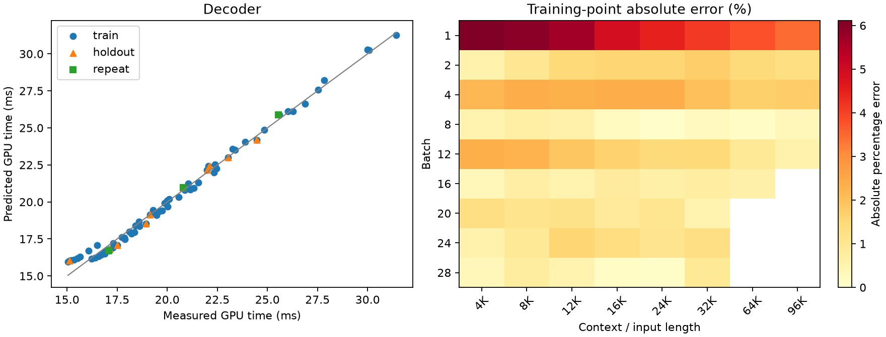
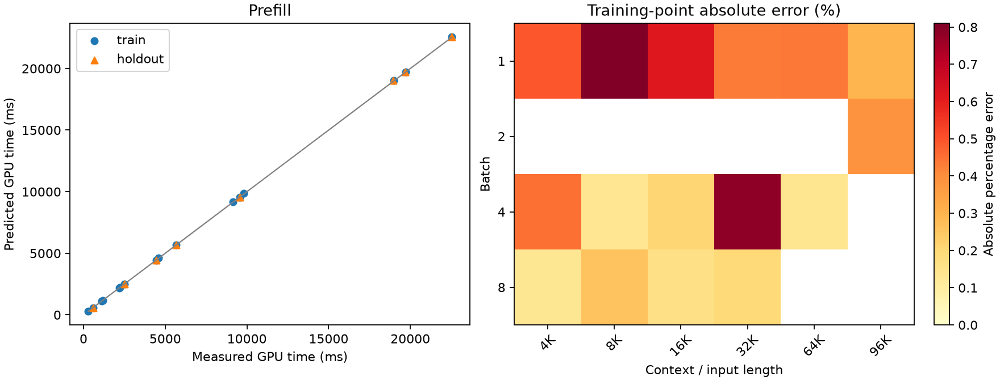

# Qwen3.8 A100 TP=4 calibration

**Scope:** complete registered grid

SGLang 0.5.21; BF16 weights/KV; FlashInfer; native communication selection.

Times cover GPU forward only. Loading, compilation, input preparation and sampling are excluded.

Primary timings use rank 0. All-rank samples and per-iteration maxima are diagnostics only.

No added per-sample TP barrier. Numerical forward checks run in separate validation processes.

TP=4 prefill is an extension of the reference TP=1 measurement.

Training data determine coefficients; holdout and repeat data do not enter fitting.

KV pool cap: maximum batch × context in the original group + 32768 tokens.

Per-shape source signatures and job IDs identify any reused decode measurements; prefill measurements use this campaign's capped pool.

| Phase | Evaluation | N | MAPE (%) | P95 error (%) | Max error (%) |
|---|---|---:|---:|---:|---:|
| decoder | train | 65 | 1.56 | 4.82 | 6.11 |
| decoder | cv_checkerboard5 | 65 | 1.61 | 4.95 | 6.27 |
| decoder | holdout | 10 | 1.66 | 4.34 | 5.96 |
| prefill | train | 16 | 0.37 | 0.79 | 0.81 |
| prefill | cv_leave_one_out | 16 | 0.55 | 1.32 | 2.32 |
| prefill | holdout | 8 | 0.37 | 0.65 | 0.77 |

## Coefficients

```json
{
  "decoder": {
    "t0_ms": 15.786028869830137,
    "tB_ms_per_request": 0.13123118604272116,
    "tK_ms_per_kv_gb": 0.17980986957737663
  },
  "prefill": {
    "p0_ms": 25.605411616747585,
    "pN_ms_per_token": 0.06442367099971257,
    "pA_ms_per_mega_attention_pair": 0.6576632617726414,
    "linear_tokens_per_s": 15522.244921505042
  }
}
```

## Accuracy by measured region

### Decoder: largest observed point errors

- train: batch=1, length=4096, measured=15.046 ms, predicted=15.966 ms, error=6.11%.
- holdout: batch=1, length=8192, measured=15.113 ms, predicted=16.014 ms, error=5.96%.
- train: batch=1, length=8192, measured=15.114 ms, predicted=16.014 ms, error=5.96%.
- train: batch=1, length=12288, measured=15.199 ms, predicted=16.062 ms, error=5.68%.
- train: batch=1, length=16384, measured=15.357 ms, predicted=16.110 ms, error=4.91%.



### Prefill: largest observed point errors

- train: batch=1, length=8192, measured=580.133 ms, predicted=575.432 ms, error=0.81%.
- train: batch=4, length=32768, measured=9805.190 ms, predicted=9882.066 ms, error=0.78%.
- holdout: batch=1, length=8192, measured=579.921 ms, predicted=575.432 ms, error=0.77%.
- train: batch=1, length=16384, measured=1176.682 ms, predicted=1169.393 ms, error=0.62%.
- train: batch=1, length=4096, measured=293.560 ms, predicted=295.002 ms, error=0.49%.



## Repeat stability

```json
[
  {
    "bs": 16,
    "ctx": 16384,
    "first": 20.801808675130207,
    "repeat": 20.809932454427084,
    "diff_percent": 0.039053235340009596
  },
  {
    "bs": 24,
    "ctx": 24576,
    "first": 25.60634969075521,
    "repeat": 25.552178955078126,
    "diff_percent": -0.21155196399055815
  },
  {
    "bs": 4,
    "ctx": 8192,
    "first": 17.10172119140625,
    "repeat": 17.082470703125,
    "diff_percent": -0.11256462472865826
  }
]
```

## Coverage

Validated shapes: 102/102 selected.
Missing or unselected points are not automatically classified as OOM.

```json
{
  "missing_selected_shapes": [],
  "registered_groups_without_file": [],
  "skipped_by_original_memory_rule": [
    {
      "id": "dec_train_bs16_ctx98304",
      "kind": "decoder",
      "bs": 16,
      "ctx": 98304,
      "split": "train",
      "corpus": "long",
      "warmups": 3,
      "iters": 9,
      "steps": 30,
      "kv_gb": 103.15
    },
    {
      "id": "dec_train_bs20_ctx65536",
      "kind": "decoder",
      "bs": 20,
      "ctx": 65536,
      "split": "train",
      "corpus": "long",
      "warmups": 3,
      "iters": 9,
      "steps": 30,
      "kv_gb": 85.98
    },
    {
      "id": "dec_train_bs20_ctx98304",
      "kind": "decoder",
      "bs": 20,
      "ctx": 98304,
      "split": "train",
      "corpus": "long",
      "warmups": 3,
      "iters": 9,
      "steps": 30,
      "kv_gb": 128.93
    },
    {
      "id": "dec_train_bs24_ctx65536",
      "kind": "decoder",
      "bs": 24,
      "ctx": 65536,
      "split": "train",
      "corpus": "long",
      "warmups": 3,
      "iters": 9,
      "steps": 30,
      "kv_gb": 103.18
    },
    {
      "id": "dec_train_bs24_ctx98304",
      "kind": "decoder",
      "bs": 24,
      "ctx": 98304,
      "split": "train",
      "corpus": "long",
      "warmups": 3,
      "iters": 9,
      "steps": 30,
      "kv_gb": 154.72
    },
    {
      "id": "dec_train_bs28_ctx65536",
      "kind": "decoder",
      "bs": 28,
      "ctx": 65536,
      "split": "train",
      "corpus": "long",
      "warmups": 3,
      "iters": 9,
      "steps": 30,
      "kv_gb": 120.38
    },
    {
      "id": "dec_train_bs28_ctx98304",
      "kind": "decoder",
      "bs": 28,
      "ctx": 98304,
      "split": "train",
      "corpus": "long",
      "warmups": 3,
      "iters": 9,
      "steps": 30,
      "kv_gb": 180.51
    },
    {
      "id": "dec_holdout_bs16_ctx98304",
      "kind": "decoder",
      "bs": 16,
      "ctx": 98304,
      "split": "holdout",
      "corpus": "long",
      "warmups": 3,
      "iters": 9,
      "steps": 30,
      "kv_gb": 103.15
    }
  ]
}
```
