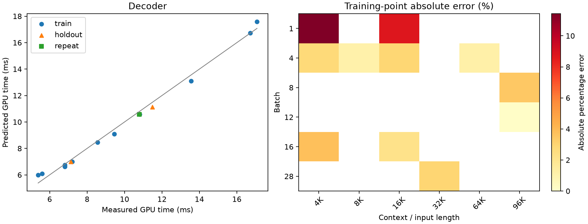
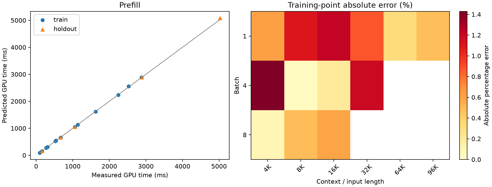

# Qwen3.6-35B-A3B A100 TP=4 calibration

**Scope:** pilot / incomplete registered grid

SGLang 0.5.21; BF16 weights/KV; FlashInfer; custom all-reduce explicitly disabled.

Times cover GPU forward only. Loading, compilation, input preparation and sampling are excluded.

Primary timings use rank 0. All-rank samples and per-iteration maxima are diagnostics only.

No added per-sample TP barrier. Numerical forward checks run in separate validation processes.

TP=4 prefill is an extension of the reference TP=1 measurement.

Training data determine coefficients; holdout and repeat data do not enter fitting.

KV pool cap: maximum batch × context in the original group + 32768 tokens.

Per-shape source signatures and job IDs identify any reused decode measurements; prefill measurements use this campaign's capped pool.

| Phase | Evaluation | N | MAPE (%) | P95 error (%) | Max error (%) |
|---|---|---:|---:|---:|---:|
| decoder | train | 11 | 3.69 | 10.09 | 11.43 |
| decoder | cv_checkerboard5 | 11 | 4.93 | 11.83 | 14.06 |
| decoder | holdout | 2 | 2.55 | 3.03 | 3.08 |
| prefill | train | 13 | 0.67 | 1.30 | 1.43 |
| prefill | cv_leave_one_out | 13 | 0.94 | 1.91 | 2.28 |
| prefill | holdout | 5 | 0.73 | 1.26 | 1.33 |

## Coefficients

```json
{
  "decoder": {
    "t0_ms": 5.794415490753896,
    "tB_ms_per_request": 0.17537127006610792,
    "tK_ms_per_kv_gb": 0.3659327379286987
  },
  "prefill": {
    "p0_ms": 32.85869083141882,
    "pN_ms_per_token": 0.014344259379978169,
    "pA_ms_per_mega_attention_pair": 0.29959028487300227,
    "linear_tokens_per_s": 69714.29988193102
  }
}
```

## Accuracy by measured region

### Decoder: largest observed point errors

- train: batch=1, length=4096, measured=5.385 ms, predicted=6.000 ms, error=11.43%.
- train: batch=1, length=16384, measured=5.602 ms, predicted=6.093 ms, error=8.76%.
- train: batch=16, length=4096, measured=9.447 ms, predicted=9.091 ms, error=3.76%.
- train: batch=8, length=98304, measured=13.561 ms, predicted=13.091 ms, error=3.47%.
- holdout: batch=8, length=65536, measured=11.480 ms, predicted=11.127 ms, error=3.08%.



### Prefill: largest observed point errors

- train: batch=4, length=4096, measured=274.013 ms, predicted=277.928 ms, error=1.43%.
- holdout: batch=1, length=8192, measured=158.318 ms, predicted=160.419 ms, error=1.33%.
- train: batch=1, length=16384, measured=311.876 ms, predicted=308.085 ms, error=1.22%.
- train: batch=4, length=32768, measured=2526.422 ms, predicted=2556.355 ms, error=1.18%.
- train: batch=1, length=8192, measured=158.670 ms, predicted=160.419 ms, error=1.10%.



## Repeat stability

```json
[
  {
    "bs": 16,
    "ctx": 16384,
    "first": 10.799479166666666,
    "repeat": 10.787498982747396,
    "diff_percent": -0.11093297865926738
  }
]
```

## Coverage

Validated shapes: 32/36 selected.
Missing or unselected points are not automatically classified as OOM.

```json
{
  "missing_selected_shapes": [
    {
      "id": "pre_train_g2",
      "batch": 8,
      "length": 32768
    },
    {
      "id": "pre_train_g3",
      "batch": 4,
      "length": 65536
    },
    {
      "id": "pre_train_g4",
      "batch": 2,
      "length": 98304
    },
    {
      "id": "pre_holdout_g2",
      "batch": 2,
      "length": 98304
    }
  ],
  "registered_groups_without_file": [
    "dec_train_bs1_ctx8192",
    "dec_train_bs1_ctx12288",
    "dec_train_bs1_ctx24576",
    "dec_train_bs1_ctx32768",
    "dec_train_bs1_ctx65536",
    "dec_train_bs1_ctx98304",
    "dec_train_bs2_ctx4096",
    "dec_train_bs2_ctx8192",
    "dec_train_bs2_ctx12288",
    "dec_train_bs2_ctx16384",
    "dec_train_bs2_ctx24576",
    "dec_train_bs2_ctx32768",
    "dec_train_bs2_ctx65536",
    "dec_train_bs2_ctx98304",
    "dec_train_bs4_ctx12288",
    "dec_train_bs4_ctx24576",
    "dec_train_bs4_ctx32768",
    "dec_train_bs4_ctx98304",
    "dec_train_bs8_ctx4096",
    "dec_train_bs8_ctx8192",
    "dec_train_bs8_ctx12288",
    "dec_train_bs8_ctx16384",
    "dec_train_bs8_ctx24576",
    "dec_train_bs8_ctx32768",
    "dec_train_bs8_ctx65536",
    "dec_train_bs12_ctx4096",
    "dec_train_bs12_ctx8192",
    "dec_train_bs12_ctx12288",
    "dec_train_bs12_ctx16384",
    "dec_train_bs12_ctx24576",
    "dec_train_bs12_ctx32768",
    "dec_train_bs12_ctx65536",
    "dec_train_bs16_ctx8192",
    "dec_train_bs16_ctx12288",
    "dec_train_bs16_ctx24576",
    "dec_train_bs16_ctx32768",
    "dec_train_bs16_ctx65536",
    "dec_train_bs16_ctx98304",
    "dec_train_bs20_ctx4096",
    "dec_train_bs20_ctx8192",
    "dec_train_bs20_ctx12288",
    "dec_train_bs20_ctx16384",
    "dec_train_bs20_ctx24576",
    "dec_train_bs20_ctx32768",
    "dec_train_bs20_ctx65536",
    "dec_train_bs24_ctx4096",
    "dec_train_bs24_ctx8192",
    "dec_train_bs24_ctx12288",
    "dec_train_bs24_ctx16384",
    "dec_train_bs24_ctx24576",
    "dec_train_bs24_ctx32768",
    "dec_train_bs24_ctx65536",
    "dec_train_bs28_ctx4096",
    "dec_train_bs28_ctx8192",
    "dec_train_bs28_ctx12288",
    "dec_train_bs28_ctx16384",
    "dec_train_bs28_ctx24576",
    "dec_holdout_bs1_ctx8192",
    "dec_holdout_bs8_ctx24576",
    "dec_holdout_bs12_ctx8192",
    "dec_holdout_bs16_ctx16384",
    "dec_holdout_bs20_ctx24576",
    "dec_holdout_bs24_ctx12288",
    "dec_holdout_bs28_ctx8192",
    "dec_holdout_bs2_ctx32768",
    "dec_holdout_bs16_ctx98304",
    "pre_holdout_g1",
    "dec_repeat_bs4_ctx8192",
    "dec_repeat_bs24_ctx24576"
  ],
  "skipped_by_original_memory_rule": [
    {
      "id": "dec_train_bs20_ctx98304",
      "kind": "decoder",
      "bs": 20,
      "ctx": 98304,
      "split": "train",
      "corpus": "long",
      "warmups": 3,
      "iters": 9,
      "steps": 30,
      "kv_gb": 40.29,
      "physical_kv_with_headroom_gb": 81.925,
      "skip_reason": "physical KV including replication and headroom exceeds preregistered budget"
    },
    {
      "id": "dec_train_bs24_ctx98304",
      "kind": "decoder",
      "bs": 24,
      "ctx": 98304,
      "split": "train",
      "corpus": "long",
      "warmups": 3,
      "iters": 9,
      "steps": 30,
      "kv_gb": 48.35,
      "physical_kv_with_headroom_gb": 98.042,
      "skip_reason": "physical KV including replication and headroom exceeds preregistered budget"
    },
    {
      "id": "dec_train_bs28_ctx65536",
      "kind": "decoder",
      "bs": 28,
      "ctx": 65536,
      "split": "train",
      "corpus": "long",
      "warmups": 3,
      "iters": 9,
      "steps": 30,
      "kv_gb": 37.62,
      "physical_kv_with_headroom_gb": 76.578,
      "skip_reason": "physical KV including replication and headroom exceeds preregistered budget"
    },
    {
      "id": "dec_train_bs28_ctx98304",
      "kind": "decoder",
      "bs": 28,
      "ctx": 98304,
      "split": "train",
      "corpus": "long",
      "warmups": 3,
      "iters": 9,
      "steps": 30,
      "kv_gb": 56.41,
      "physical_kv_with_headroom_gb": 114.158,
      "skip_reason": "physical KV including replication and headroom exceeds preregistered budget"
    }
  ]
}
```
