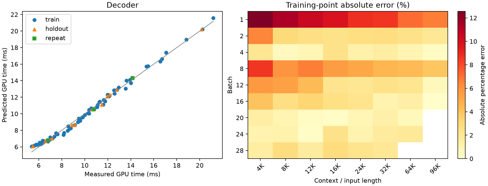
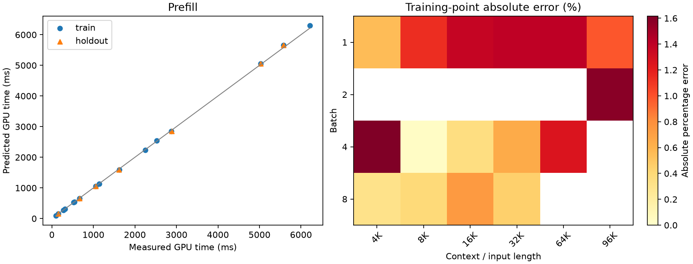

# Qwen3.6-35B-A3B A100 TP=4 calibration

**Scope:** pilot / incomplete registered grid

SGLang 0.5.21; BF16 weights/KV; FlashInfer; custom all-reduce explicitly disabled.

Times cover GPU forward only. Loading, compilation, input preparation and sampling are excluded.

Primary timings use rank 0. All-rank samples and per-iteration maxima are diagnostics only.

No added per-sample TP barrier. Numerical forward checks run in separate validation processes.

TP=4 prefill is an extension of the reference TP=1 measurement.

Training data determine coefficients; holdout and repeat data do not enter fitting.

KV pool cap: maximum batch × context in the original group + 32768 tokens.

Per-shape source signatures and job IDs identify any reused decode measurements; prefill measurements use this campaign's capped pool.

| Phase | Evaluation | N | MAPE (%) | P95 error (%) | Max error (%) |
|---|---|---:|---:|---:|---:|
| decoder | train | 68 | 3.30 | 9.45 | 12.56 |
| decoder | cv_checkerboard5 | 68 | 3.41 | 9.73 | 12.34 |
| decoder | holdout | 11 | 2.81 | 8.27 | 11.35 |
| prefill | train | 16 | 0.89 | 1.59 | 1.62 |
| prefill | cv_leave_one_out | 16 | 1.15 | 2.04 | 2.26 |
| prefill | holdout | 7 | 1.05 | 1.47 | 1.52 |

## Coefficients

```json
{
  "decoder": {
    "t0_ms": 5.86119419631903,
    "tB_ms_per_request": 0.17015940654692963,
    "tK_ms_per_kv_gb": 0.36087908512589706
  },
  "prefill": {
    "p0_ms": 32.77604788015336,
    "pN_ms_per_token": 0.014400833086764668,
    "pA_ms_per_mega_attention_pair": 0.2897567972151283,
    "linear_tokens_per_s": 69440.42709022627
  }
}
```

## Accuracy by measured region

### Decoder: largest observed point errors

- train: batch=1, length=4096, measured=5.385 ms, predicted=6.062 ms, error=12.56%.
- train: batch=1, length=8192, measured=5.471 ms, predicted=6.092 ms, error=11.36%.
- holdout: batch=1, length=8192, measured=5.471 ms, predicted=6.092 ms, error=11.35%.
- train: batch=1, length=12288, measured=5.542 ms, predicted=6.122 ms, error=10.47%.
- train: batch=1, length=16384, measured=5.602 ms, predicted=6.152 ms, error=9.83%.



### Prefill: largest observed point errors

- train: batch=4, length=4096, measured=274.013 ms, predicted=278.442 ms, error=1.62%.
- train: batch=2, length=98304, measured=5575.948 ms, predicted=5664.211 ms, error=1.58%.
- holdout: batch=2, length=98304, measured=5579.649 ms, predicted=5664.211 ms, error=1.52%.
- train: batch=1, length=65536, measured=1621.615 ms, predicted=1598.797 ms, error=1.41%.
- train: batch=1, length=32768, measured=669.591 ms, predicted=660.225 ms, error=1.40%.



## Repeat stability

```json
[
  {
    "bs": 16,
    "ctx": 16384,
    "first": 10.799479166666666,
    "repeat": 10.787498982747396,
    "diff_percent": -0.11093297865926738
  },
  {
    "bs": 24,
    "ctx": 24576,
    "first": 14.16093037923177,
    "repeat": 14.157175699869791,
    "diff_percent": -0.026514355070098306
  },
  {
    "bs": 4,
    "ctx": 8192,
    "first": 6.815470886230469,
    "repeat": 6.80075937906901,
    "diff_percent": -0.21585459621258032
  }
]
```

## Coverage

Validated shapes: 105/106 selected.
Missing or unselected points are not automatically classified as OOM.

```json
{
  "missing_selected_shapes": [
    {
      "id": "pre_holdout_g1",
      "batch": 4,
      "length": 65536
    }
  ],
  "registered_groups_without_file": [],
  "skipped_by_original_memory_rule": [
    {
      "id": "dec_train_bs20_ctx98304",
      "kind": "decoder",
      "bs": 20,
      "ctx": 98304,
      "split": "train",
      "corpus": "long",
      "warmups": 3,
      "iters": 9,
      "steps": 30,
      "kv_gb": 40.29,
      "physical_kv_with_headroom_gb": 81.925,
      "skip_reason": "physical KV including replication and headroom exceeds preregistered budget"
    },
    {
      "id": "dec_train_bs24_ctx98304",
      "kind": "decoder",
      "bs": 24,
      "ctx": 98304,
      "split": "train",
      "corpus": "long",
      "warmups": 3,
      "iters": 9,
      "steps": 30,
      "kv_gb": 48.35,
      "physical_kv_with_headroom_gb": 98.042,
      "skip_reason": "physical KV including replication and headroom exceeds preregistered budget"
    },
    {
      "id": "dec_train_bs28_ctx65536",
      "kind": "decoder",
      "bs": 28,
      "ctx": 65536,
      "split": "train",
      "corpus": "long",
      "warmups": 3,
      "iters": 9,
      "steps": 30,
      "kv_gb": 37.62,
      "physical_kv_with_headroom_gb": 76.578,
      "skip_reason": "physical KV including replication and headroom exceeds preregistered budget"
    },
    {
      "id": "dec_train_bs28_ctx98304",
      "kind": "decoder",
      "bs": 28,
      "ctx": 98304,
      "split": "train",
      "corpus": "long",
      "warmups": 3,
      "iters": 9,
      "steps": 30,
      "kv_gb": 56.41,
      "physical_kv_with_headroom_gb": 114.158,
      "skip_reason": "physical KV including replication and headroom exceeds preregistered budget"
    }
  ]
}
```
