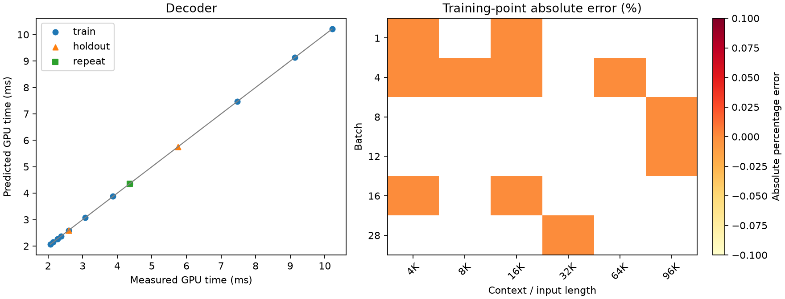
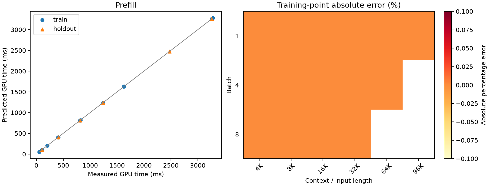

# Qwen3.8 A100 TP=4 calibration

**Scope:** pilot / incomplete registered grid

SGLang 0.5.21; BF16 weights/KV; FlashInfer; native communication selection.

Times cover GPU forward only. Loading, compilation, input preparation and sampling are excluded.

Primary timings use rank 0. All-rank samples and per-iteration maxima are diagnostics only.

No added per-sample TP barrier. Numerical forward checks run in separate validation processes.

TP=4 prefill is an extension of the reference TP=1 measurement.

Training data determine coefficients; holdout and repeat data do not enter fitting.

| Phase | Evaluation | N | MAPE (%) | P95 error (%) | Max error (%) |
|---|---|---:|---:|---:|---:|
| decoder | train | 11 | 0.00 | 0.00 | 0.00 |
| decoder | cv_checkerboard5 | 11 | 0.00 | 0.00 | 0.00 |
| decoder | holdout | 2 | 0.00 | 0.00 | 0.00 |
| prefill | train | 15 | 0.00 | 0.00 | 0.00 |
| prefill | cv_leave_one_out | 15 | 0.00 | 0.00 | 0.00 |
| prefill | holdout | 6 | 0.00 | 0.00 | 0.00 |

## Coefficients

```json
{
  "decoder": {
    "t0_ms": 1.9999999999999987,
    "tB_ms_per_request": 0.03999999999999983,
    "tK_ms_per_kv_gb": 0.10000000000000005
  },
  "prefill": {
    "p0_ms": 0.9999999999999986,
    "pN_ms_per_token": 0.012345678899999999,
    "pA_ms_per_mega_attention_pair": 0.004999999999999969,
    "linear_tokens_per_s": 81000.00073710001
  }
}
```

## Accuracy by measured region

### Decoder: largest observed point errors

- holdout: batch=4, length=16384, measured=2.590 ms, predicted=2.590 ms, error=0.00%.
- holdout: batch=8, length=65536, measured=5.756 ms, predicted=5.756 ms, error=0.00%.
- repeat: batch=16, length=16384, measured=4.358 ms, predicted=4.358 ms, error=0.00%.
- train: batch=12, length=98304, measured=10.211 ms, predicted=10.211 ms, error=0.00%.
- train: batch=16, length=16384, measured=4.358 ms, predicted=4.358 ms, error=0.00%.



### Prefill: largest observed point errors

- holdout: batch=1, length=8192, measured=102.304 ms, predicted=102.304 ms, error=0.00%.
- holdout: batch=1, length=32768, measured=408.228 ms, predicted=408.228 ms, error=0.00%.
- holdout: batch=8, length=8192, measured=811.429 ms, predicted=811.429 ms, error=0.00%.
- holdout: batch=8, length=32768, measured=3258.820 ms, predicted=3258.820 ms, error=0.00%.
- holdout: batch=1, length=98304, measured=1238.789 ms, predicted=1238.789 ms, error=0.00%.



## Repeat stability

```json
[
  {
    "bs": 16,
    "ctx": 16384,
    "first": 4.3579869184,
    "repeat": 4.3579869184,
    "diff_percent": 0.0
  }
]
```

## Coverage

Validated shapes: 35/36 selected.
Missing or unselected points are not automatically classified as OOM.

```json
{
  "missing_selected_shapes": [
    {
      "id": "pre_train_g4",
      "batch": 2,
      "length": 98304
    }
  ],
  "registered_groups_without_file": [
    "dec_train_bs1_ctx8192",
    "dec_train_bs1_ctx12288",
    "dec_train_bs1_ctx24576",
    "dec_train_bs1_ctx32768",
    "dec_train_bs1_ctx65536",
    "dec_train_bs1_ctx98304",
    "dec_train_bs2_ctx4096",
    "dec_train_bs2_ctx8192",
    "dec_train_bs2_ctx12288",
    "dec_train_bs2_ctx16384",
    "dec_train_bs2_ctx24576",
    "dec_train_bs2_ctx32768",
    "dec_train_bs2_ctx65536",
    "dec_train_bs2_ctx98304",
    "dec_train_bs4_ctx12288",
    "dec_train_bs4_ctx24576",
    "dec_train_bs4_ctx32768",
    "dec_train_bs4_ctx98304",
    "dec_train_bs8_ctx4096",
    "dec_train_bs8_ctx8192",
    "dec_train_bs8_ctx12288",
    "dec_train_bs8_ctx16384",
    "dec_train_bs8_ctx24576",
    "dec_train_bs8_ctx32768",
    "dec_train_bs8_ctx65536",
    "dec_train_bs12_ctx4096",
    "dec_train_bs12_ctx8192",
    "dec_train_bs12_ctx12288",
    "dec_train_bs12_ctx16384",
    "dec_train_bs12_ctx24576",
    "dec_train_bs12_ctx32768",
    "dec_train_bs12_ctx65536",
    "dec_train_bs16_ctx8192",
    "dec_train_bs16_ctx12288",
    "dec_train_bs16_ctx24576",
    "dec_train_bs16_ctx32768",
    "dec_train_bs16_ctx65536",
    "dec_train_bs20_ctx4096",
    "dec_train_bs20_ctx8192",
    "dec_train_bs20_ctx12288",
    "dec_train_bs20_ctx16384",
    "dec_train_bs20_ctx24576",
    "dec_train_bs20_ctx32768",
    "dec_train_bs24_ctx4096",
    "dec_train_bs24_ctx8192",
    "dec_train_bs24_ctx12288",
    "dec_train_bs24_ctx16384",
    "dec_train_bs24_ctx24576",
    "dec_train_bs24_ctx32768",
    "dec_train_bs28_ctx4096",
    "dec_train_bs28_ctx8192",
    "dec_train_bs28_ctx12288",
    "dec_train_bs28_ctx16384",
    "dec_train_bs28_ctx24576",
    "dec_holdout_bs1_ctx8192",
    "dec_holdout_bs8_ctx24576",
    "dec_holdout_bs12_ctx8192",
    "dec_holdout_bs16_ctx16384",
    "dec_holdout_bs20_ctx24576",
    "dec_holdout_bs24_ctx12288",
    "dec_holdout_bs28_ctx8192",
    "dec_holdout_bs2_ctx32768",
    "pre_holdout_g1",
    "dec_repeat_bs4_ctx8192",
    "dec_repeat_bs24_ctx24576"
  ],
  "skipped_by_original_memory_rule": [
    {
      "id": "dec_train_bs16_ctx98304",
      "kind": "decoder",
      "bs": 16,
      "ctx": 98304,
      "split": "train",
      "corpus": "long",
      "warmups": 3,
      "iters": 9,
      "steps": 30,
      "kv_gb": 103.15
    },
    {
      "id": "dec_train_bs20_ctx65536",
      "kind": "decoder",
      "bs": 20,
      "ctx": 65536,
      "split": "train",
      "corpus": "long",
      "warmups": 3,
      "iters": 9,
      "steps": 30,
      "kv_gb": 85.98
    },
    {
      "id": "dec_train_bs20_ctx98304",
      "kind": "decoder",
      "bs": 20,
      "ctx": 98304,
      "split": "train",
      "corpus": "long",
      "warmups": 3,
      "iters": 9,
      "steps": 30,
      "kv_gb": 128.93
    },
    {
      "id": "dec_train_bs24_ctx65536",
      "kind": "decoder",
      "bs": 24,
      "ctx": 65536,
      "split": "train",
      "corpus": "long",
      "warmups": 3,
      "iters": 9,
      "steps": 30,
      "kv_gb": 103.18
    },
    {
      "id": "dec_train_bs24_ctx98304",
      "kind": "decoder",
      "bs": 24,
      "ctx": 98304,
      "split": "train",
      "corpus": "long",
      "warmups": 3,
      "iters": 9,
      "steps": 30,
      "kv_gb": 154.72
    },
    {
      "id": "dec_train_bs28_ctx65536",
      "kind": "decoder",
      "bs": 28,
      "ctx": 65536,
      "split": "train",
      "corpus": "long",
      "warmups": 3,
      "iters": 9,
      "steps": 30,
      "kv_gb": 120.38
    },
    {
      "id": "dec_train_bs28_ctx98304",
      "kind": "decoder",
      "bs": 28,
      "ctx": 98304,
      "split": "train",
      "corpus": "long",
      "warmups": 3,
      "iters": 9,
      "steps": 30,
      "kv_gb": 180.51
    },
    {
      "id": "dec_holdout_bs16_ctx98304",
      "kind": "decoder",
      "bs": 16,
      "ctx": 98304,
      "split": "holdout",
      "corpus": "long",
      "warmups": 3,
      "iters": 9,
      "steps": 30,
      "kv_gb": 103.15
    }
  ]
}
```
